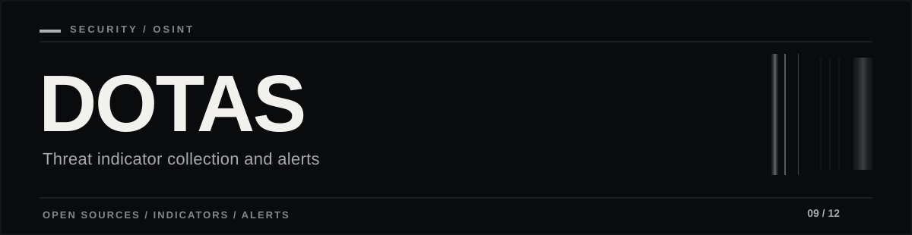
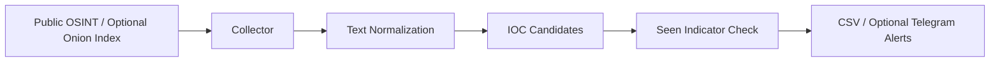

<picture>
  <source media="(max-width: 600px)" srcset="assets/portfolio-banner-mobile.svg">
  
</picture>

<a href="README.md">한국어</a> / <strong>English</strong>

# DOTAS — OSINT Collection and Indicator Alerts

**Public-source intelligence · Optional Tor proxy · Indicator extraction · Deduplication · Alerts**

## Project purpose

Threat sources have inconsistent formats and repeated items. DOTAS experiments with **collecting public index/OSINT documents, extracting email/domain IOC candidates, suppressing duplicates, and routing observations to CSV/Telegram outputs**.

## Workflow

1. Read a configured public source (optionally through a SOCKS5h Tor proxy)
2. Extract and normalize candidate indicators; suppress repeated records
3. Preserve observations and issue alerts

**Evidence boundary:** This documents the code and design, not successful live access to every Onion source or a verified production monitoring service. IOC matches are leads for investigation, not confirmed compromises.

[Follow-on CTI prototype: DotasPlus](https://github.com/rasasoe/DotasPlus)

---

## What it does

The original DOTAS project describes gathering public threat-related references from configured clearnet sources and optional Tor-accessible index/directory sources, extracting simple indicators, and issuing notifications.

| Pipeline stage | Function |
| --- | --- |
| Public-source collection | HTTP and optional configured Tor SOCKS proxy |
| Text processing | HTML extraction and keyword-based filtering |
| IOC candidate extraction | Simple domain/email expressions |
| Deduplication | Locally records already-seen indicators |
| Reporting and alerts | CSV output and optional Telegram bot messages |

## Scope and limitations

- **Publicly reachable sources only:** do not collect stolen credentials, private data or unapproved systems.
- **Tor is not absolute anonymity:** transport configuration can reduce certain forms of exposure but does not guarantee safety or privacy.
- **IOC extraction is a candidate signal:** a regex match is not proof of compromise or a reliable threat classification.
- This README reflects the documented prototype capabilities; it is **not** a claim of fresh live-source validation.

## Getting started

See the **[original Korean README](README.md)** for the exact dependencies, source configuration, Tor SOCKS settings (if used), notification setup, sample logs, and troubleshooting.

## Related CTI work

The newer [DotasPlus](https://github.com/rasasoe/DotasPlus) repository explores a more structured document → IOC → protected asset → incident pipeline. These are separate projects with different scopes.

---

*DOTAS · OSINT / Threat Intelligence · Prototype*
