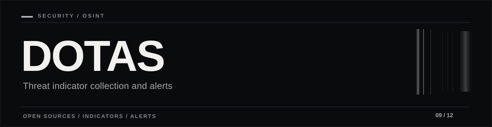

<picture>
  <source media="(max-width: 600px)" srcset="assets/portfolio-banner-mobile.svg">
  
</picture>

<p align="right"><strong>한국어</strong> / <a href="README.en.md">English</a></p>

# DOTAS — 공개 위협 정보 수집·알림

**OSINT · Tor(선택) · IOC 추출 · 중복 제거 · Telegram 알림**

## 왜 만들었나

다양한 공개 위협 정보에서 보안 관련 지표를 찾아도 **소스별 형식이 다르고 같은 알림이 반복**되면 실제로 확인하기 어렵습니다. DOTAS는 공개 인덱스·OSINT 문서를 수집해 이메일·도메인 등의 IOC를 추출하고, 중복을 제거해 알림 흐름으로 연결하는 실험 프로젝트입니다.

## 처리 흐름

1. **수집:** 승인된 공개 소스와 선택적인 Tor 프록시 경로
2. **정리:** HTML 텍스트 변환, 정규식 기반 IOC 후보 식별 및 중복 방지
3. **전달:** CSV 기록과 Telegram 경고 경로

**검증 범위:** 저장소의 설계·수집 코드 및 안내를 설명하며, 현재 외부 Onion 소스 전체의 연결 성공이나 실시간 운영을 확인했다는 의미는 아닙니다. IOC는 침해 사실의 확정 증거가 아닌 조사 후보입니다.

**후속 확장:** [DotasPlus](https://github.com/rasasoe/DotasPlus)는 출처·원문·IOC를 보호 자산 및 Incident까지 연결하는 방향으로 별도 개발했습니다.

---

## 상세 기능

### ✔ 1. Tor 기반 Onion Intelligence 수집

* `.onion` 주소에 직접 접근하여 데이터 수집
* Tor SOCKS5h 프록시 사용 → **SOCKS5h 사용 시 DNS 질의도 Tor 경로로 전달하도록 구성**
* 사용 소스:

  * **Ahmia onion 인덱스**
  * **dark.fail onion 디렉토리**

### ✔ 2. OSINT Collector (Clearnet)

* deepdarkCTI GitHub 프로젝트 기반
* 랜섬웨어 그룹 / 텔레그램 위협 행위자 정보 자동 수집

### ✔ 3. IOC 자동 분석

* 이메일 / 도메인 자동 추출 (Regex 기반)
* 키워드 기반 필터링
* HTML → Plain text 변환

### ✔ 4. 중복 알림 방지 (De-duplication)

* 탐지된 IOC는 `seen_indicators.txt`에 기록
* 이미 본 IOC는 Telegram 알림 재발송 없음

### ✔ 5. Telegram 실시간 알림

* Bot API 직접 호출
* 경보 형식으로 즉시 전달
* CSV(`findings.csv`) 자동 업데이트

---

## 시스템 아키텍처

```text
            +------------------+
            |   DARK WEB       |
            |   (.onion)       |
            +------------------+
       (Tor SOCKS5h: 127.0.0.1:9050)
                      |
                      v
            +------------------+
            |   Collector      |
            | (fetch_url)      |
            +------------------+
                      |
            +--------------------------+
            |      Analyzer            |
            | - HTML -> Text clean     |
            | - Keyword filter         |
            | - Email/Domain extract   |
            +--------------------------+
                      |
        +-------------+--------------+
        |                            |
        v                            v
+-------------------+      +-----------------------+
|   CSV Logger      |      |  Telegram Alert Bot   |
|  findings.csv     |      |  send_telegram()      |
+-------------------+      +-----------------------+
                  |
                  v
         +-----------------------+
         |  seen_indicators.txt  |
         |  (Duplicate Filter)   |
         +-----------------------+
```

---

## 데이터 소스

### Tor 경로

| Source Name                  | URL                                                                      |
| ---------------------------- | ------------------------------------------------------------------------ |
| **Ahmia Onion Search**       | `http://juhanurmihxlp77nkq76byazcldy2hlmovfu2epvl5ankdibsot4csyd.onion/` |
| **DarkFail Onion Directory** | `http://darkfailenbsdla5mal2mxn2uz66od5vtzd5qozslagrfzachha3f3id.onion/` |

### Clearnet OSINT

| Source Name                          | URL                                                                                     |
| ------------------------------------ | --------------------------------------------------------------------------------------- |
| DeepDarkCTI – Ransomware Index       | `https://raw.githubusercontent.com/fastfire/deepdarkCTI/main/ransomware_gang.md`        |
| DeepDarkCTI – Telegram Threat Actors | `https://raw.githubusercontent.com/fastfire/deepdarkCTI/main/telegram_threat_actors.md` |

---

## 디렉토리 구조

```text
DOTAS/
│── dotas_v1_3.py        # 메인 실행 파일
│── findings.csv         # 수집된 IOC 로그
│── seen_indicators.txt  # 중복 알림 방지 DB
│── README.md            # 설명 문서
└── requirements.txt     # 패키지 목록
```

---

## 환경 요구사항

```
Python 3.9+
Tor service (0.4.x 이상)
Linux 계열 환경 권장 (Kali / Ubuntu)
안정적인 인터넷 + SOCKS Proxy 환경
```

필수 패키지:

```text
requests
beautifulsoup4
pysocks
urllib3
python-telegram-bot
```

설치:

```bash
pip install -r requirements.txt
```

---

## 설치와 실행

### 1) Tor 설치 및 실행

```bash
sudo apt update
sudo apt install tor -y
sudo service tor start
```

### 2) Telegram 설정

```python
TELEGRAM_TOKEN = "YOUR_BOT_TOKEN_HERE"
CHAT_ID        = "YOUR_CHAT_ID"
```

### 3) 실행

```bash
python3 dotas_v1_3.py
```

---

## 실행 로그 예시

```text
>> [DOTAS] 다크웹 & OSINT 위협 모니터링 시스템 가동
   - CSV 파일   : findings.csv
   - History 파일: seen_indicators.txt

[Cycle 시작] 2025-12-04 11:20:18
[*] 소스 처리 시작: Ahmia Onion Search (http://juhanurmihxlp77nkq76byazcldy2hlmovfu2epvl5ankdibsot4csyd.onion/) [TOR=True]
[+] Fetch 성공: ... (size=182034)
[탐지] Ahmia Onion Search에서 domain 발견: leaked-admin-panel.com
🚨 [DOTAS Threat Alert]
Source : Ahmia Onion Search
Type   : domain
Value  : leaked-admin-panel.com
Snippet: ...
------------------------------------
```

---

## 문제 해결

### 1️⃣ `.onion` 접속 실패 (`General SOCKS server failure`)

```bash
sudo systemctl status tor@default
torsocks curl https://check.torproject.org
```

* Tor 데몬 상태 및 네트워크 부트스트랩 여부 확인

### 2️⃣ `Invalid onion site address`

* `.onion` 주소 자체가 종료되었거나 잘못된 경우
* v3 주소(56자)인지 확인 필요

### 3️⃣ 중복 알림이 안 막힐 때

* `seen_indicators.txt` 내용 확인
* 파일 삭제 시, 모든 IOC를 새로 보는 것으로 인식

### 4️⃣ HTML 파싱 문제

* BeautifulSoup의 `.get_text()`로 HTML → 텍스트 변환 중
* 특수 포맷(md, json 등)이 많다면 추가 파서 구현 가능

---

## 라이선스

본 프로젝트는 MIT 라이센스를 따릅니다.
누구나 자유롭게 수정 및 재사용할 수 있습니다.

---

## 사용 범위와 주의사항

> DOTAS는 **보안 연구·교육·위협 인텔리전스 학습용**으로 제작되었습니다.
> 무단 크롤링·불법 침투·허가되지 않은 onion/웹 자원 접근은
> 관련 법률에 의해 처벌될 수 있습니다.
>
> 반드시 **본인이 소유한 자산 또는 명확한 허가를 받은 환경에서만** 사용하십시오.
